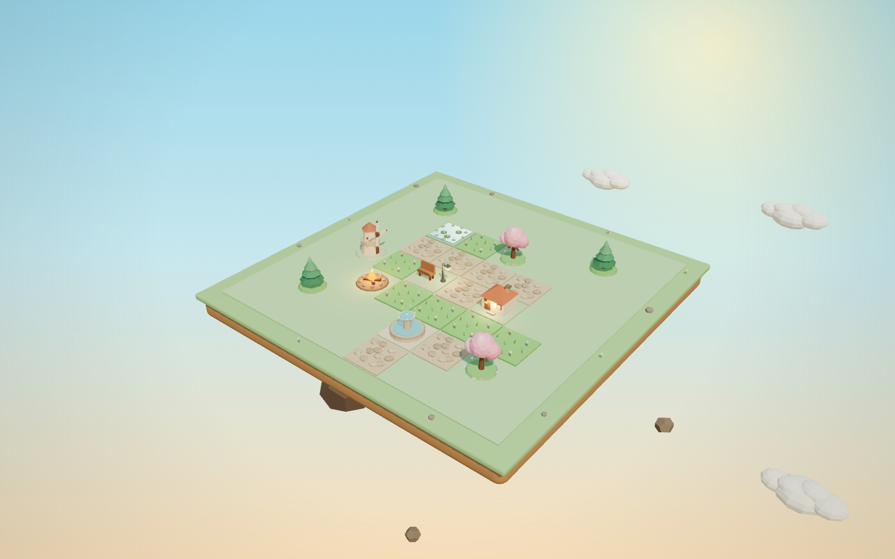
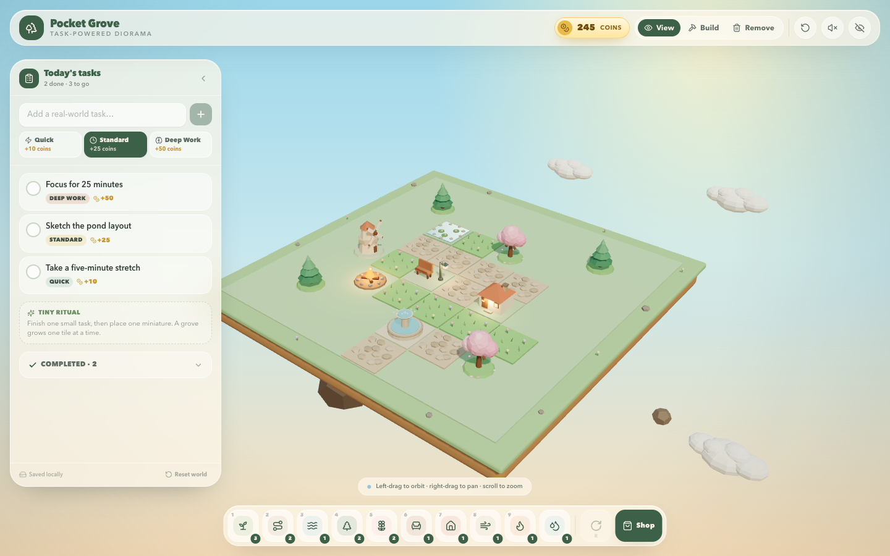
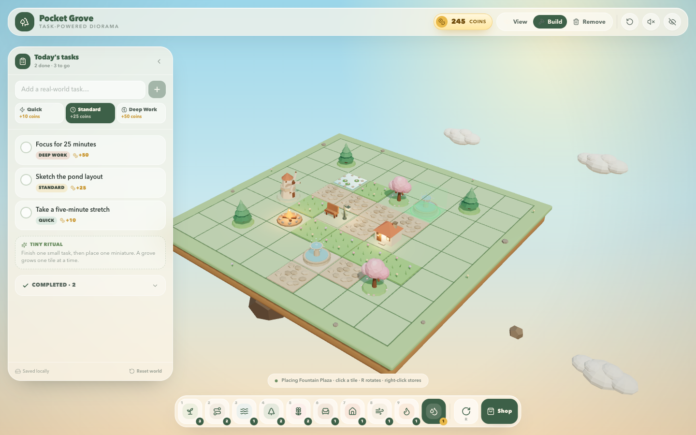
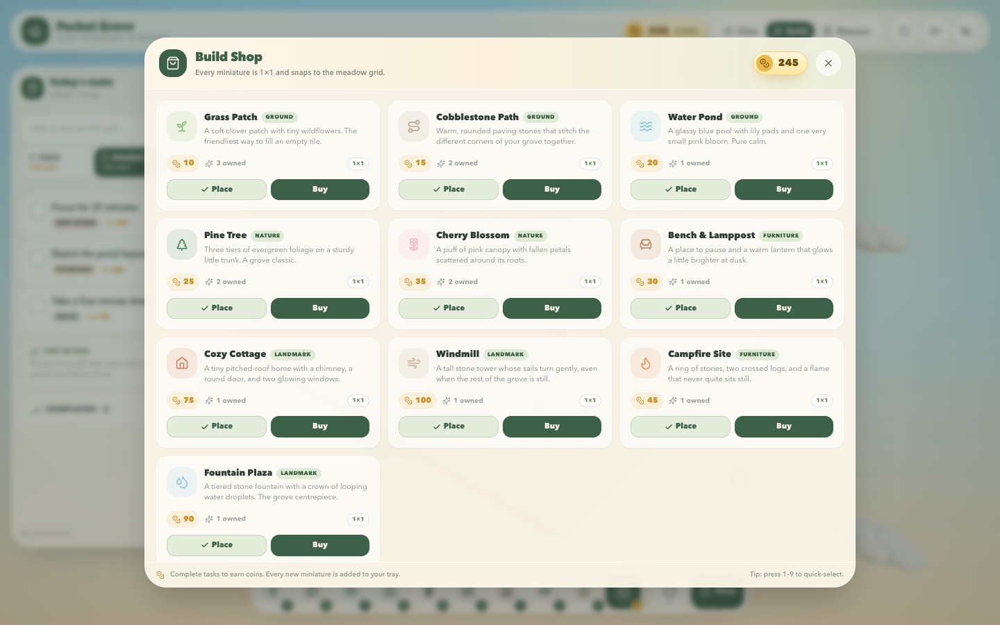
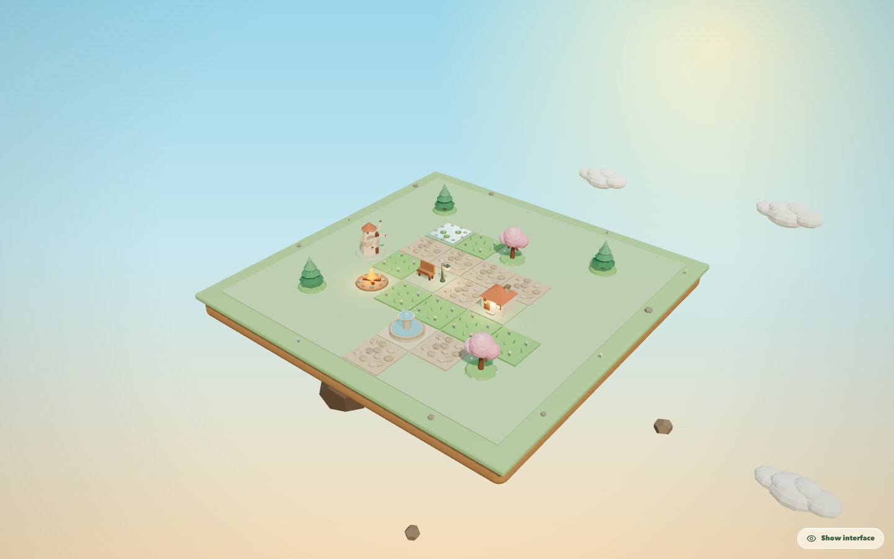

# Pocket Grove

### Finish real tasks. Earn coins. Grow a tiny floating world.

Pocket Grove is a polished, desktop-first **3D isometric task manager and miniature world builder**. Complete small real-world tasks to earn coins, spend them in the Build Shop, and place charming clay-style miniatures on an 8 × 8 floating meadow. Everything runs in the browser with no backend, no account, and no external art assets.

[](https://github.com/yx0128/pocket-grove/actions/workflows/ci.yml)
[](LICENSE)
[](https://react.dev)
[](https://threejs.org)
[](https://vite.dev)
[](#development-checks)

> **Session transparency:** this project was designed, built, tested, documented, and released in one AI-assisted session. Wall-clock time, token counts, cost, and reproduction queries live in [STATE.md](STATE.md). The reusable playbook is in [skill/pocket-grove](skill/pocket-grove/SKILL.md).

---

## Why it feels good

- **A real economy, not a checkbox.** Quick (`+10`), Standard (`+25`), and Deep Work (`+50`) tasks pay coins. Completed tasks cannot be un-checked, so the reward loop is honest.
- **Ten hand-built 1 × 1 miniatures.** Grass, cobblestone, pond, pine, cherry blossom, bench & lamppost, cottage, windmill, campfire, and fountain — every mesh is procedural Three.js geometry. No broken CDN links, no missing GLBs.
- **A wide, quiet canvas.** A floating 8 × 8 diorama with a soft sky gradient, drifting low-poly clouds, warm sun shadows, and a full orbit/pan/zoom camera.
- **Small interactions that land.** Ghost previews, green/red validity tinting, 90° rotation, bounce-in placement, a puff of sparkles, and synthesized Web Audio chimes.
- **Build, view, or tidy up.** Dedicated View, Build, and Remove modes; hide the entire interface for a clean photo moment.
- **Your world survives refresh.** Tasks, coins, tray quantities, and every placed tile persist to `localStorage` and are validated on load.

| Daylight overview | Build mode |
| --- | --- |
|  |  |

| Build Shop | Clean photo mode |
| --- | --- |
|  |  |

A 1280 × 720 layout check is kept at [docs/screenshot-1280x720.png](docs/screenshot-1280x720.png).

---

## Quick start

```bash
git clone https://github.com/yx0128/pocket-grove.git
cd pocket-grove
npm install
npm run dev
```

Open **http://localhost:5173**.

```bash
npm run build
npm run preview
```

Node **22+** is recommended (the repo includes `.nvmrc`). The app is desktop-first and targets **1280 × 720 and above**.

---

## The starter experience

A brand-new save begins with:

- **60 coins**
- **2 free starter tiles** — one Grass Patch and one Pine Tree
- **3 sample tasks**
- **Build mode** active with the Grass Patch selected

Complete a task, place a tile, then visit the shop. **Reset world** in the task panel footer returns to this exact starter state.

---

## Controls

| Input | Action |
| --- | --- |
| **Left click** an empty tile | Place the selected miniature |
| **Left click** an occupied tile | Shows the invalid-placement tint and a short notice |
| **R** or the Rotate button | Rotate the ghost / next placement by 90° |
| **Right click** a placed miniature | Return it to your tray (a drag does not remove) |
| **Right-drag** | Pan the camera |
| **Left-drag** (View, Remove, or Build with nothing selected) | Orbit the camera |
| **Scroll wheel** | Zoom, clamped so the camera never clips under the island |
| **1–9** | Quick-select a hotbar miniature |
| **B / V / X** | Build / View / Remove mode |
| **Esc** | Close the shop, cancel placement, or return to View |
| **Rotate button** | Same as `R` |
| **Hide interface** | Photo mode: hides the HUD and switches to View |
| **Mute** | Toggles synthesized sound effects |

---

## Economy

| Miniature | Price | Category |
| --- | ---: | --- |
| Grass Patch | 10 | Ground |
| Cobblestone Path | 15 | Ground |
| Water Pond | 20 | Ground |
| Pine Tree | 25 | Nature |
| Bench & Lamppost | 30 | Furniture |
| Cherry Blossom | 35 | Nature |
| Campfire Site | 45 | Furniture |
| Cozy Cottage | 75 | Landmark |
| Fountain Plaza | 90 | Landmark |
| Windmill | 100 | Landmark |

| Task tier | Reward | Suggested use |
| --- | ---: | --- |
| Quick | +10 | A glass of water, a stretch, one inbox item |
| Standard | +25 | A focused half hour, a tidy desk |
| Deep Work | +50 | A meaningful focus session |

All prices and rewards come from [src/data/catalog.ts](src/data/catalog.ts), the single source of truth for the shop, hotbar, starter inventory, and task economy.

---

## Architecture at a glance

```text
React 18 + TypeScript + Vite + Tailwind
└── App shell
    ├── Scene (R3F Canvas, transparent over CSS sky gradient)
    │   ├── Lighting (hemisphere + warm sun + cool fill)
    │   ├── IslandGrid
    │   │   ├── IslandBase + 8×8 instanced tiles + border details
    │   │   ├── GridLines (Build/Remove only)
    │   │   ├── GhostPreview (lifted, translucent, green/red cell)
    │   │   ├── PlacedPiece (bounce + puff animation)
    │   │   └── invisible pointer plane (hover / click / right-click)
    │   ├── Clouds + floating rocks
    │   └── OrbitControls (distance + polar clamps)
    └── Glass HUD
        ├── TopBar (coins, modes, reset camera, mute, hide UI)
        ├── TaskSidebar (add, complete, delete, completed, reset)
        ├── BottomHotbar (10 slots, 1–9 quick keys, rotate, shop)
        ├── ShopModal
        └── Toasts
Zustand persist → localStorage (`pocket-grove-v1`)
└── coins · tasks · inventory · placed · muted
```

### Source map

| Path | Responsibility |
| --- | --- |
| `src/components/canvas/Scene.tsx` | Canvas, lighting, CSS-sky setup, camera controls, debug hook |
| `src/components/canvas/IslandGrid.tsx` | Island, grid, raycast, placement, removal, bounce/puff |
| `src/components/canvas/GhostPreview.tsx` | Lifted translucent preview + validity cell |
| `src/components/canvas/AssetMeshes.tsx` | All ten procedural 1 × 1 assets |
| `src/components/canvas/Clouds.tsx` | Drifting clouds + floating rocks |
| `src/components/ui/*` | Top bar, task panel, shop, hotbar, toasts, mode hint |
| `src/data/catalog.ts` | Catalog, prices, reward tiers, starter inventory/tasks |
| `src/store/useWorldStore.ts` | Economy, tasks, placement, persistence, sanitization |
| `src/lib/grid.ts` | 8 × 8 coordinate conversion + vertical constants |
| `src/lib/sound.ts` | Lazy Web Audio synthesizer |
| `src/components/ui/ItemIcon.tsx` | Lucide icon mapping for catalog items |

More detail: [Architecture](docs/ARCHITECTURE.md) · [Product spec](docs/PRODUCT_SPEC.md) · [Design system](docs/DESIGN_SYSTEM.md) · [Save format](docs/STATE_FORMAT.md) · [Agent guide](AGENTS.md).

---

## Persistence

Everything is local. The Zustand `persist` middleware saves under `pocket-grove-v1`:

```json
{
  "state": {
    "coins": 60,
    "tasks": [],
    "inventory": { "grass": 1, "pine": 1 },
    "placed": [],
    "muted": false
  },
  "version": 1
}
```

Persisted data is treated as untrusted: invalid tasks, out-of-bounds tiles, duplicate cells, impossible counts, and unknown item ids are repaired or dropped on load. See [docs/STATE_FORMAT.md](docs/STATE_FORMAT.md).

---

## Development checks

```bash
npm run typecheck
npm run lint
npm test
npm run build
```

The suite covers the starter state, reward tiers, double-reward prevention, task cleanup, purchases, insufficient funds, selection, placement, occupied/out-of-bounds rejection, pick-up, and reset.

### Visual QA screenshots

The release screenshots are generated from a demo save with headless Chrome:

```bash
npm run build
npm run preview -- --port 4173
node scripts/capture.mjs
```

`scripts/capture.mjs` uses the Chrome DevTools Protocol directly (no Playwright/Puppeteer dependency), injects a deterministic demo save, disables CSS animations for stable captures, and fails if the browser logs an error. For a 1280 × 720 pass:

```bash
VIEWPORT=1280x720 SHOT_SUFFIX=-1280 node scripts/capture.mjs
```

Details and results: [docs/QA.md](docs/QA.md) · [Reproduction guide](docs/REPRODUCTION.md).

---

## Release & agent documentation

| Document | Purpose |
| --- | --- |
| [AGENTS.md](AGENTS.md) | Complete handoff for AI coding agents, including pitfalls |
| [docs/PRODUCT_SPEC.md](docs/PRODUCT_SPEC.md) | Full original product specification |
| [docs/REPRODUCTION.md](docs/REPRODUCTION.md) | Step-by-step rebuild, QA, release, and metrics capture |
| [docs/ARCHITECTURE.md](docs/ARCHITECTURE.md) | Data model, rendering pipeline, interaction logic, decisions |
| [docs/DESIGN_SYSTEM.md](docs/DESIGN_SYSTEM.md) | Palette, type, surfaces, motion, 3D art direction |
| [docs/STATE_FORMAT.md](docs/STATE_FORMAT.md) | Persisted schema and sanitization rules |
| [docs/QA.md](docs/QA.md) | Test matrix, browser QA, sizes, limitations |
| [CONTRIBUTING.md](CONTRIBUTING.md) | Local workflow and contribution rules |
| [SECURITY.md](SECURITY.md) | Threat model and reporting |
| [CHANGELOG.md](CHANGELOG.md) | Release history |
| [STATE.md](STATE.md) | Session time, tokens, cost, model credits |

---

## Skill

The repeatable process is packaged as **`pocket-grove-builder`**:

- In-repo copy: [skill/pocket-grove/SKILL.md](skill/pocket-grove/SKILL.md)
- GitHub backup: [github.com/yx0128/pocket-grove-skill](https://github.com/yx0128/pocket-grove-skill)
- Local install path used in the original session: `~/.claude/skills/pocket-grove-builder/`

It covers the full build order, React Three Fiber traps, persistence validation, headless visual QA, professional docs, GitHub publishing without repeated keychain prompts, state/token accounting, and the acceptance checklist.

---

## Credits

Built with [OpenCode](https://opencode.ai) `1.19.5` and the model **`opencode-go/deepseek-v4.1-flash`**. Session time, token buckets, provider cost, and the SQL used to retrieve them are in [STATE.md](STATE.md).

The 3D art direction is intentionally asset-free: every miniature, cloud, and island edge is generated at runtime with Three.js geometry and pastel clay materials. No external models, HDRs, fonts, or network services are required.

Brand banner: [docs/banner.svg](docs/banner.svg).

## License

[MIT](LICENSE) © 2026 Pocket Grove contributors
